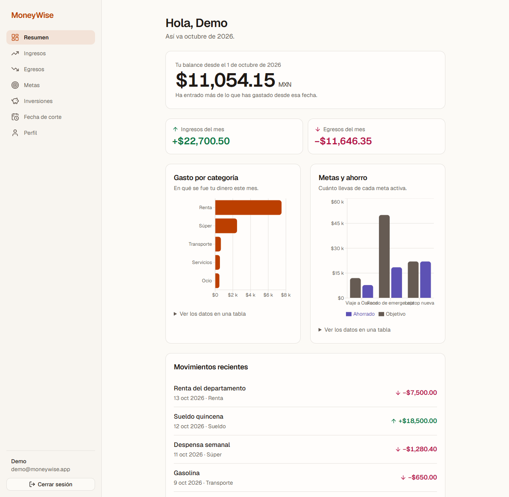
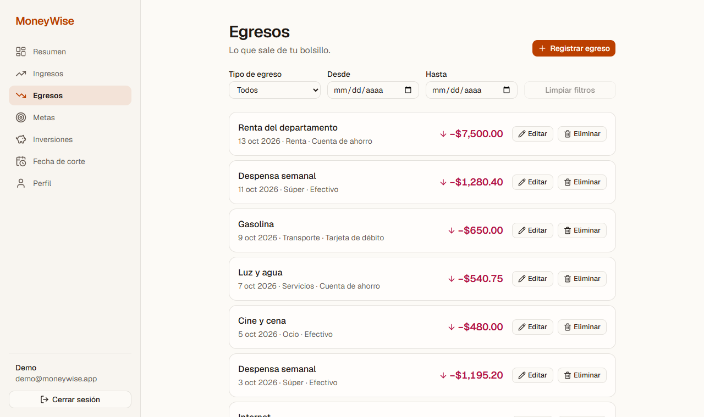
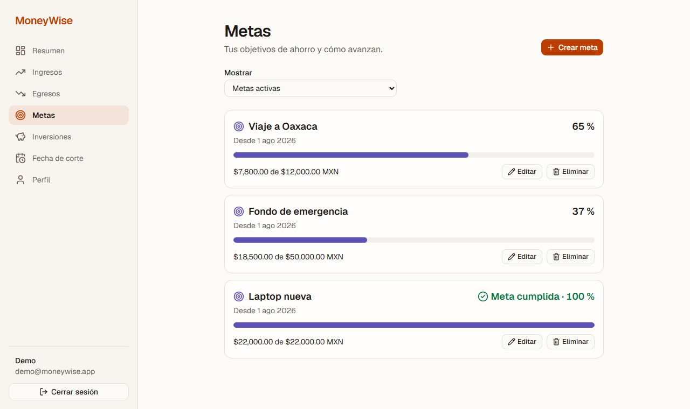
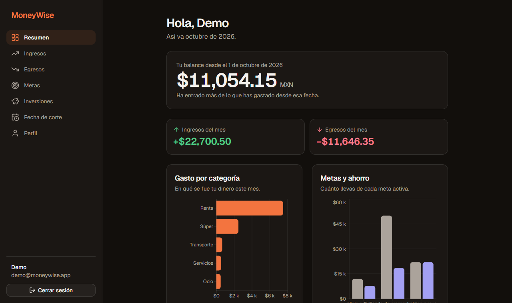
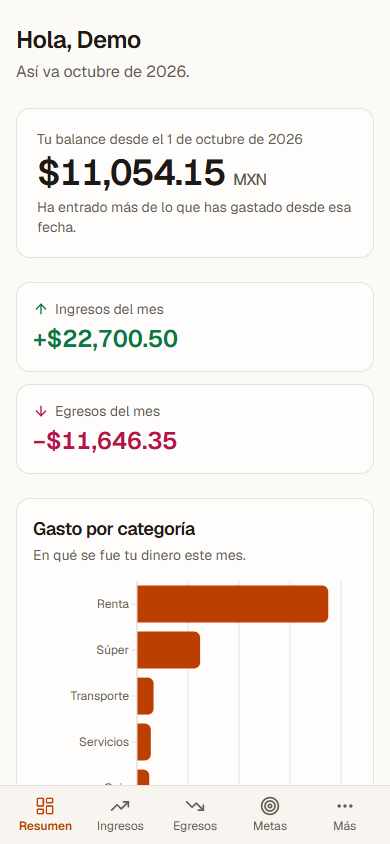
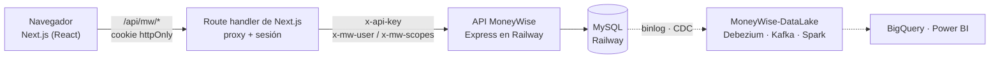

# MoneyWise · Frontend

Aplicación web para llevar las finanzas personales: registra ingresos y egresos, fija metas de ahorro y mira de un vistazo cómo vas en el mes. Es el cliente de [`MoneyWise-Integracion`](https://github.com/dodamivid/MoneyWise-Integracion) (API en Railway) y parte de un proyecto que incluye un [data lake con CDC](https://github.com/dodamivid/MoneyWise-DataLake).

> **Demo en vivo:** pendiente de publicar. Los pasos están en [`docs/despliegue.md`](docs/despliegue.md).



|                                               |                                        |
| --------------------------------------------- | -------------------------------------- |
|               |            |
|  |  |

## Qué hace

- **Resumen** con el balance como protagonista, ingresos y egresos del mes, gasto por categoría, metas contra ahorro y movimientos recientes.
- **Ingresos y egresos**: lista paginada con filtros, alta, edición y baja con confirmación.
- **Metas de ahorro** con progreso, **inversiones** y **fecha de corte** (de la que depende el balance).
- **Cuenta**: registro, inicio de sesión, perfil, cambio de contraseña y recuperación.
- Modo claro y oscuro (según el sistema), responsive y accesible (WCAG 2.2 AA, ver [`docs/accesibilidad.md`](docs/accesibilidad.md)).

## Arquitectura



Las flechas punteadas pertenecen a otro repositorio; este frontend solo habla con la API.

**Decisiones que importan:**

- **El navegador nunca ve la `x-api-key`.** Todas las llamadas pasan por `/api/mw/*`, un proxy en el servidor de Next.js que la agrega. No hay variables `NEXT_PUBLIC_` y el módulo de configuración usa `server-only`.
- **El backend confía en `x-mw-user` y `x-mw-scopes`**, así que el proxy descarta todo header que mande el navegador y los fija desde la sesión.
- **Sesión en cookie `httpOnly` firmada** (HMAC-SHA256), sin guardar el token del backend, que los módulos no usan.
- **Un solo formato de respuesta.** El backend mezcla `{ok,data}`, `{status,data}`, `mensaje`/`message`; el proxy los normaliza y conserva el `traceId` para rastrear errores.

Más detalle en [`docs/api.md`](docs/api.md) y [`docs/auth.md`](docs/auth.md).

## Stack

Next.js 16 (App Router) · TypeScript · Tailwind 4 · shadcn/ui (Base UI) · TanStack Query · React Hook Form + Zod · Recharts · Vitest + Testing Library · Playwright

## Cómo correrlo

Requiere Node 24.

```cmd
npm install
copy .env.example .env.local
```

Edita `.env.local` y completa `API_KEY` (Railway → Variables) y `SESSION_SECRET` (mínimo 32 caracteres):

```cmd
node -e "console.log(require('crypto').randomBytes(32).toString('hex'))"
npm run dev
```

Abre <http://localhost:3000>.

### Sin la key de Railway: backend simulado

```cmd
npm run mock:api
```

y en `.env.local`: `API_BASE_URL=http://localhost:4010` y `API_KEY=mock-key`. Ver [`docs/mock-backend.md`](docs/mock-backend.md).

### Usuario demo

```cmd
npm run seed:demo
```

Crea `demo@moneywise.app` / `Demo12345` con unas 25 peticiones de datos de ejemplo (la base de Railway es de prueba: no conviene cargarla de más).

## Scripts

| Comando                           | Qué hace                                    |
| --------------------------------- | ------------------------------------------- |
| `npm run dev`                     | Servidor de desarrollo                      |
| `npm run build` / `start`         | Compilar y servir en producción             |
| `npm run lint`                    | ESLint                                      |
| `npm run format` / `format:check` | Prettier (escribe / solo verifica)          |
| `npm test`                        | Pruebas unitarias y de componentes (Vitest) |
| `npm run test:e2e`                | Prueba de punta a punta (Playwright)        |
| `npm run mock:api`                | Backend simulado en el puerto 4010          |
| `npm run seed:demo`               | Crea el usuario demo con datos de prueba    |

## Estructura

```
src/
  app/
    (auth)/        login, registro, olvido, restablecer
    (app)/         resumen, ingresos, egresos, metas, inversiones, ahorro, perfil
    api/mw/        proxy hacia el backend
  components/      ui (shadcn), auth, layout, states, movimientos, metas, ...
  lib/
    api/           backend, cliente, normalización de respuestas, tipos
    auth/          sesión, esquemas, acciones de servidor
    format.ts      dinero MXN y fechas en hora de México
  proxy.ts         protección de rutas (middleware en Next 16)
mocks/             backend simulado
e2e/               pruebas de punta a punta
docs/              diseño, API, auth, accesibilidad, pruebas, despliegue
```

## Documentación

| Documento                                                | Contenido                                       |
| -------------------------------------------------------- | ----------------------------------------------- |
| [`docs/diseno.md`](docs/diseno.md)                       | Identidad visual, tokens, voz y wireframes      |
| [`docs/api.md`](docs/api.md)                             | Proxy, rutas y formato de respuesta             |
| [`docs/auth.md`](docs/auth.md)                           | Sesión, autenticación del backend, recuperación |
| [`docs/catalogos.md`](docs/catalogos.md)                 | Catálogos y selects                             |
| [`docs/layout-y-formatos.md`](docs/layout-y-formatos.md) | Layout, estados y formatos                      |
| [`docs/accesibilidad.md`](docs/accesibilidad.md)         | Auditoría WCAG 2.2 AA                           |
| [`docs/pruebas.md`](docs/pruebas.md)                     | Estrategia de pruebas y CI                      |
| [`docs/mock-backend.md`](docs/mock-backend.md)           | Backend simulado                                |
| [`docs/despliegue.md`](docs/despliegue.md)               | Despliegue en Vercel y revisión de secretos     |

## Repositorios relacionados

- [`MoneyWise-Integracion`](https://github.com/dodamivid/MoneyWise-Integracion): la API (Node.js, TypeScript, Express, MySQL).
- [`MoneyWise-DataLake`](https://github.com/dodamivid/MoneyWise-DataLake): captura de cambios en tiempo real y modelo Bronze → Silver → Gold.

## Estado y límites conocidos

- La autenticación del backend es **simulada** (`x-mw-user` y `x-mw-scopes`): el token que devuelve el login no lo validan los módulos.
- El backend **no envía correos**: el enlace de recuperación de contraseña aparece en su consola.
- Este frontend se probó de punta a punta contra el backend simulado; la verificación contra el backend real de Railway requiere su `API_KEY`.
